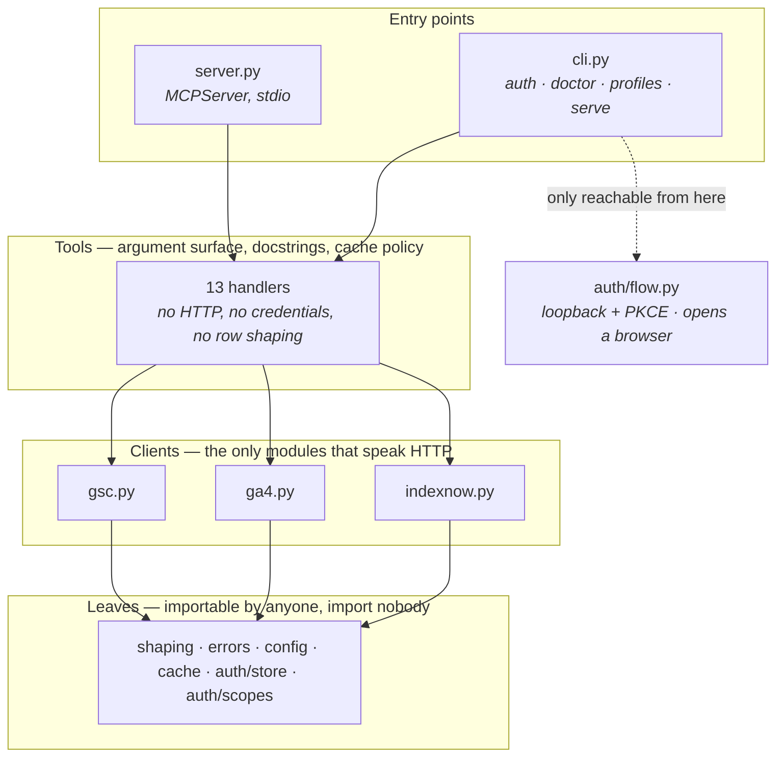

<div align="center">

<h1>seo-analytics-mcp</h1>

**Google Search Console, GA4 and IndexNow — as an MCP server.**

Ask Claude about your own sites. What's ranking, what changed, what's indexed, what's converting.

[](https://pypi.org/project/seo-analytics-mcp/)
[](https://pypi.org/project/seo-analytics-mcp/)
[](LICENSE)
[](https://modelcontextprotocol.io)
[](tests/)

</div>

---

```
"Which pages lost the most clicks in the last 28 days versus the 28 before?"
"How is /pricing doing?"
"Is https://example.com/new-post indexed yet?"
"Which pages rank on page one but get almost no clicks?"
"Top 20 queries for the blog last month, and which of them convert in GA4."
```

You authorise **your own Google account** against an OAuth client in **your own** Google Cloud
project. Nothing about your access flows through anyone else, this repository contains no
credentials, and every Google quota you spend is your own.

<br>

## Contents

[Install](#install) · [Setup](#setup) · [The seven-day problem](#the-seven-day-problem) ·
[Tools](#tools) · [Response shape](#what-a-response-looks-like) · [Configuration](#configuration) ·
[Writes](#writes) · [Profiles](#profiles) · [Design](#design) · [Troubleshooting](#troubleshooting) ·
[Development](#development)

<br>

## Install

Requires **Python 3.10+** and [uv](https://docs.astral.sh/uv/getting-started/installation/).

```bash
uvx seo-analytics-mcp doctor      # no install needed — prints your setup steps, in order
```

`doctor` is the whole onboarding experience. It tells you exactly what is missing and what to
run next, at every stage. If you read nothing else here, run that.

<br>

## Setup

Six clicks in the Google Cloud console, then one command. Ten minutes, once.

<table>
<tr><td width="40"><b>1</b></td><td>

**Create a Google Cloud project** — or reuse one.
[console.cloud.google.com/projectcreate](https://console.cloud.google.com/projectcreate)

</td></tr>
<tr><td><b>2</b></td><td>

**Enable the APIs.** Search Console is required; the GA4 pair is optional.

[`searchconsole`](https://console.cloud.google.com/apis/library/searchconsole.googleapis.com) ·
[`analyticsdata`](https://console.cloud.google.com/apis/library/analyticsdata.googleapis.com) ·
[`analyticsadmin`](https://console.cloud.google.com/apis/library/analyticsadmin.googleapis.com)

</td></tr>
<tr><td><b>3</b></td><td>

**Configure the consent screen, then press Publish app.**
[console.cloud.google.com/auth/overview](https://console.cloud.google.com/auth/overview)

Choose **External** and publish. You are the only user of your own app, so Google's personal-use
exception applies and no verification is needed. Workspace users can choose **Internal** instead.

**Do not skip the Publish step** — see [below](#the-seven-day-problem).

</td></tr>
<tr><td><b>4</b></td><td>

**Create an OAuth client of type `Desktop app`** and download the JSON.
[console.cloud.google.com/auth/clients](https://console.cloud.google.com/auth/clients)

A **Web application** client cannot do the loopback redirect this server needs. `doctor` checks
for this specific mistake, because it is the easy one to make.

</td></tr>
<tr><td><b>5</b></td><td>

**Authorise, once, from a terminal:**

```bash
uvx seo-analytics-mcp auth --client-secret ~/Downloads/client_secret_*.json
```

Your browser opens. Google says *"Google hasn't verified this app"* — expected for your own
client: **Advanced → Continue**. The token lands in your profile directory at mode `0600`.

</td></tr>
<tr><td><b>6</b></td><td>

**Check, then connect:**

```bash
uvx seo-analytics-mcp doctor      # eleven checks; exit 0 means it will work
```

</td></tr>
</table>

### Connect it

<details open>
<summary><b>Claude Code</b></summary>

```bash
claude mcp add seo \
  -e GSC_DEFAULT_SITE=sc-domain:example.com \
  -e GA4_DEFAULT_PROPERTY=properties/123456789 \
  -- uvx seo-analytics-mcp
```

</details>

<details>
<summary><b>Claude Desktop</b> — <code>claude_desktop_config.json</code></summary>

```json
{
  "mcpServers": {
    "seo": {
      "command": "uvx",
      "args": ["seo-analytics-mcp"],
      "env": {
        "GSC_DEFAULT_SITE": "sc-domain:example.com",
        "GA4_DEFAULT_PROPERTY": "properties/123456789"
      }
    }
  }
}
```

Then quit Claude Desktop completely (⌘Q — closing the window is not enough) and reopen.

</details>

> [!NOTE]
> There is **no credential path in that config**. The token lives in the profile directory that
> `seo-mcp auth` wrote, so the whole block is safe to paste into a GitHub issue.

<br>

## The seven-day problem

> [!WARNING]
> **If the server works and then stops about a week later, this is why.**
>
> Google issues refresh tokens that **expire after seven days** for any external OAuth app whose
> publishing status is still *Testing*. The obvious setup path — create project, create client,
> add yourself as a test user — leaves you there.

The fix is one click: on the consent screen, set the audience to **External** and press
**Publish app**. Then `uvx seo-analytics-mcp auth --reauth`.

`doctor` flags a token young enough to still be a Testing token, and every `invalid_grant` error
from the server explains this in full. It is not a bug in the server — but it will be the most
common issue filed against it.

<br>

## Tools

Thirteen tools: ten map to upstream operations, two join sources, and one exists purely so the
model can tell a confused user what to do.

| | Tool | What it does |
|:--|:--|:--|
| 🔎 | `gsc_list_sites` | Properties this account can read, with permission level |
| 🔎 | `gsc_search_analytics` | Clicks, impressions, CTR, position by any dimension combination |
| 🔎 | `gsc_compare_periods` | Two windows diffed — biggest movers, both directions |
| 🔎 | `gsc_inspect_url` | Index status, coverage, canonical, last crawl, rich results |
| 🔎 | `gsc_list_sitemaps` | Submitted sitemaps with warnings and error counts |
| ✍️ | `gsc_submit_sitemap` | Submits a sitemap — write scope **and** explicit confirm |
| 📊 | `ga4_list_properties` | Accounts and properties, to resolve a numeric property ID |
| 📊 | `ga4_run_report` | Arbitrary `runReport` — dimensions, metrics, filters, ordering |
| 📊 | `ga4_landing_pages` | Sessions, engagement, conversions by landing page |
| ⚡ | `indexnow_verify_key` | Checks the key file is published correctly |
| ⚡ | `indexnow_submit` | Batch submit — dry run by default, token-gated confirm |
| 🔗 | `page_report` | One URL: GSC trend, top queries, GA4 engagement, index status |
| 🩺 | `auth_status` | Active profile, scopes, which APIs answer, what to run next |

<br>

## What a response looks like

Every read tool returns the same four keys. Bounded, self-describing, and carrying its own
caveats.

```jsonc
{
  "summary": {
    "source": "gsc",
    "rows_returned": 10,        // what you see
    "rows_matched": 1847,       // what exists upstream
    "date_range": "2026-07-29..2026-08-25",   // resolved, always echoed
    "data_state": "final",
    "totals": { "clicks": 4730, "impressions": 512903, "ctr": 0.0092, "position": 12.4 }
  },
  "rows": [ /* capped at min(row_limit, 1000) */ ],
  "notes": [
    "Google anonymises rare queries: these rows do NOT sum to property totals.",
    "dataState=final excludes the most recent 2-3 days.",
    "1837 further rows were not included inline."
  ],
  "export": "~/.../exports/a1b2c3.csv"        // only when rows spilled
}
```

Three conventions hold everywhere:

**Totals cover every row fetched**, not just the rows shown — a model that sees ten rows and a
total for ten cannot tell truncation from reality. Rates are never averaged: `ctr` is recomputed
from clicks ÷ impressions, `position` is impression-weighted, `engagementRate` is
engaged ÷ sessions.

**Caveats travel with the data.** Whichever layer knows the caveat appends it: the client knows
the `query` dimension was requested, `shape()` knows how many rows it dropped, GA4 knows the
response was sampled. Docstrings alone lose them exactly when the model is looking at the numbers.

**Errors name the fix.** A 403 tells you which grant to check and where — never a raw Google
error body.

```
The authorised Google account has no access to sc-domain:example.com. Confirm the
account you authorised is the one with access — Search Console grants are per-property
under Settings > Users and permissions, GA4 grants are per-property under Admin >
Property access management. If access was added recently, run `seo-mcp auth --reauth`.
```

<br>

## Configuration

Every variable is optional. Precedence: **tool argument → environment → profile `config.json`**.

| Variable | Purpose |
|:--|:--|
| `GSC_DEFAULT_SITE` | Default property, e.g. `sc-domain:example.com` — so prompts never name it |
| `GA4_DEFAULT_PROPERTY` | Default GA4 property, e.g. `properties/123456789` |
| `SEO_MCP_PROFILE` | Which profile to use (default: `default`) |
| `SEO_MCP_HOME` | Override the profile root directory |
| `INDEXNOW_HOST` · `INDEXNOW_KEY` | Required only for IndexNow |
| `SEO_MCP_LOG_LEVEL` | `DEBUG` for verbose logging — always on **stderr**, never stdout |

### Dates

Every date argument accepts `YYYY-MM-DD`, `today`, `yesterday` or `NdaysAgo`. Responses echo the
absolute range they actually used, because a model that guesses today's date wrong produces an
empty result that reads as *"traffic went to zero"*.

Search Console lags 2–3 days and retains ~16 months; ranges outside those bounds are flagged or
refused rather than silently returning nothing. GA4 reports in the property's own timezone, so
its dates do not line up exactly with Search Console's — the responses say so where it matters.

<br>

## Writes

Two tools act on the world outside your machine. Both are deliberately awkward.

| | |
|:--|:--|
| `gsc_submit_sitemap` | Needs the write scope (**not** granted by default) **and** `confirm=true`. Without confirm it is a dry run. |
| `indexnow_submit` | Verifies your key file, then returns a `submission_token` bound by hash to that exact URL list. Submitting needs `confirm=true` **and** that token. |

> [!IMPORTANT]
> A `confirm` flag alone is **not** a safety mechanism — it is an argument the *model* fills in,
> and the same misreading that produces the wrong URLs produces `confirm=true` beside them.
>
> The token is unforgeable without a dry run, and change one URL and it stops matching. Both
> tools also carry `destructiveHint` annotations, so a client that gates destructive tools behind
> its own approval prompt will do so.

Read-only scopes are the default. A stranger installing an SEO tool that immediately asks for
permission to modify their Search Console properties will reasonably decline.

<br>

## Profiles

Several Google accounts on one machine — for agencies holding client properties side by side.

```bash
uvx seo-analytics-mcp auth --profile client-a --client-secret ./client-a.json
uvx seo-analytics-mcp auth --profile client-b --client-secret ./client-b.json
uvx seo-analytics-mcp profiles list
```

Set `SEO_MCP_PROFILE` per MCP server entry. **Cache keys include the profile**, so two accounts
can never serve each other's data.

A profile is one directory — the first thing you will ever ask a user to delete:

```bash
uvx seo-analytics-mcp profiles rm client-a --yes
```

They live in `~/Library/Application Support/seo-mcp/` (macOS), `$XDG_CONFIG_HOME/seo-mcp/`
(Linux) or `%APPDATA%\seo-mcp\` (Windows).

<br>

## Design

Four layers, strictly downhill. Get this wrong and the auth flow ends up inside a tool call,
which is the failure the whole design exists to prevent.



**The browser flow must never run inside a tool call.** An MCP tool that blocks on stdio waiting
for a human to finish a consent screen looks like a hung server, and the model has no way to
help. One CLI command, run once, is the whole difference — and a test walks the AST of every
module to enforce it.

Other rules the tests enforce mechanically: `shaping.py` imports no Google library (which is why
the row logic is fully unit-testable with no credentials), tools import no HTTP library, and
nothing on the server path calls `print()` — on a stdio transport, stdout carries JSON-RPC and a
single stray print corrupts the stream.

<br>

## Troubleshooting

| Symptom | Cause |
|:--|:--|
| Worked, then stopped after a week | OAuth app still in *Testing* — [see above](#the-seven-day-problem) |
| `client type: FAIL … this is a Web client` | Create a **Desktop app** OAuth client instead |
| `no access to sc-domain:…` | Wrong Google account, or no grant on that property |
| `…API is not enabled` | Enable it on the project that issued your OAuth client, then wait a minute |
| GA4 returns a 400 | An incompatible dimension/metric pair — not every GA4 dimension works with every metric |
| Server never appears in the client | Run `doctor` first, then check your client's MCP log |

**Every issue report should include `seo-mcp doctor --json`.** It contains no credentials — only
paths, versions, which checks passed and which APIs answered.

<br>

## Development

```bash
uv sync --extra dev
uv run pytest -q                    # 147 tests · no credentials · no network
uv run python scripts/smoke.py      # drives the server over real stdio JSON-RPC
uv run ruff check src tests
```

<details>
<summary>Without <code>uv</code></summary>

```bash
python3 -m venv .venv && ./.venv/bin/pip install -e ".[dev]"
./.venv/bin/python -m pytest -q
./.venv/bin/python scripts/smoke.py ./.venv/bin/seo-mcp
```

</details>

`scripts/smoke.py` starts the server as a subprocess, completes the MCP handshake, lists the
tools and calls several — using a throwaway profile directory, so your real token is untouched.
It is the fastest way to confirm the protocol side works before any Google credential exists.

To poke at it by hand, the MCP Inspector needs nothing beyond Node:

```bash
npx @modelcontextprotocol/inspector ./.venv/bin/seo-mcp            # web UI
npx @modelcontextprotocol/inspector --cli ./.venv/bin/seo-mcp \
    --method tools/call --tool-name auth_status                    # scriptable
```

**Not covered by automated tests:** the OAuth flow itself and live IndexNow submission. Both need
a human and a real domain, and mocking them would only test the mock. They belong in a short
manual release checklist.

<br>

## Two things it will not do

> [!NOTE]
> **IndexNow does not reach Google.** Participants are Bing, Yandex, Naver, Seznam.cz, Yep and
> Amazon — one endpoint propagates to all of them. Google does not participate, and Google's own
> Indexing API only accepts pages carrying `JobPosting` or `BroadcastEvent` structured data. If
> you install this expecting faster Google indexing, you will be disappointed.

> [!NOTE]
> **Query rows never sum to totals.** Google anonymises rare queries, so any breakdown by the
> `query` dimension undercounts. Every response carrying that dimension repeats the caveat,
> because a model handed those rows will otherwise compute confidently wrong percentages.

<br>

## Contributing

Issues and pull requests welcome. The credential-free test suite runs on every push across
Linux, macOS and Windows on Python 3.10 and 3.13 — if it passes locally it will pass in CI.

Renaming a tool or changing an argument breaks every saved prompt a user has. Those changes go in
[CHANGELOG.md](CHANGELOG.md) and are a minor bump before 1.0, a major one after.

<br>

## Licence

[MIT](LICENSE).

<div align="center"><br>
<sub>Built for the <a href="https://modelcontextprotocol.io">Model Context Protocol</a>.</sub>
</div>
